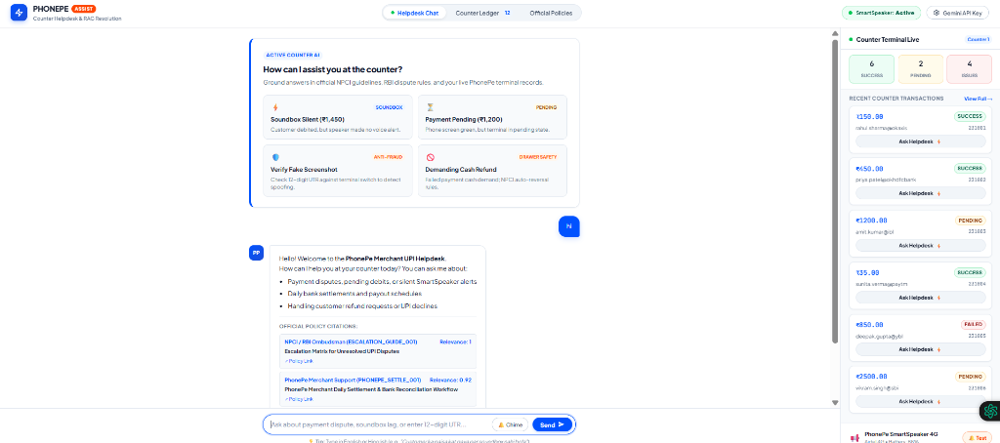
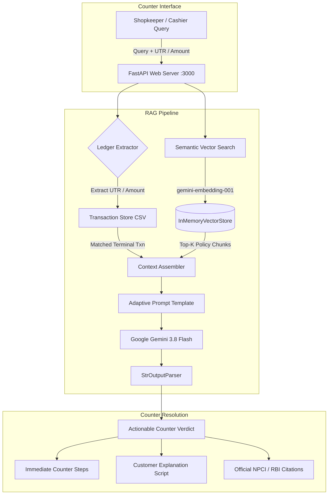

# 🚀 PhonePe Merchant UPI Copilot — Domain-Specific RAG System

An AI-powered, policy-grounded Retrieval-Augmented Generation (RAG) assistant designed specifically for Indian retail shopkeepers, cashiers, and merchants using **PhonePe QR codes** and **SmartSpeaker Soundboxes**.



---

## 📌 Executive Summary & Problem Context

In high-volume Indian retail counters (kiranas, restaurants, supermarkets), digital UPI payments occasionally face operational edge cases that create immediate counter tension:

1. **Fake Screenshot Fraud:** Fraudsters use spoof apps to display fake green "Payment Successful" screens and fabricated 12-digit UTRs.
2. **Core Banking System (CBS) Latency:** Customer accounts are debited, but bank switch latency leaves the transaction in an intermediate **"Pending"** state.
3. **Soundbox Audio Lags:** Cellular/4G network latency occasionally delays voice announcements even after money reaches the acquiring switch.
4. **Cash Refund Demands:** Customers whose payments fail or hang demand cash out of the counter drawer, exposing merchants to double-loss upon automated bank reversal.
5. **Daily Settlement Questions:** Shopkeepers need clear visibility on when counter collections reach their linked bank accounts under NPCI T+1 turnaround times.

**PhonePe Merchant UPI Copilot** solves this by combining **real-time counter ledger matching** with a **policy-grounded LangChain RAG pipeline** backed by Google Gemini.

---

## ⚡ Key Capabilities & Architectural Highlights

### 1. 🛡️ Anti-Fraud & Strict Proof-of-Credit Verification
* Adheres to official **NPCI & PhonePe safety mandates**: never recommends releasing goods solely on customer phone screenshots or SMS.
* Enforces validation strictly via the **PhonePe SmartSpeaker voice alert** or the **PhonePe for Business App statement**.
* Protects the merchant drawer by blocking cash refunds for pending digital transactions, citing automated banking auto-reversal policies.

### 2. ⚡ Real-Time Counter Ledger Reconciliation
* Automatically scans queries for **12-digit UTR numbers**, transaction IDs (`TXN_PP_1003`), or monetary amounts (e.g., `₹1,450`).
* Cross-references the query with the active counter ledger (`data/phonepe_transactions.csv`) and displays terminal status, customer VPA, and failure reasons alongside AI guidance.

### 3. 🧠 Adaptive, Intent-Driven RAG Pipeline
* Powered by **LangChain** and **Google Gemini (`gemini-3.8-flash`)** using Google's **`models/gemini-embedding-001`** semantic vector store.
* **Direct Bottom-Line Answers:** Formulates an immediate 1-line verdict (e.g. `⚠️ Do not release goods yet` or `❌ Do not give cash refund`), 2–3 actionable counter steps, and a calm, polite script to speak to the customer in English or Hinglish.
* **Zero-Crash Local Synthesizer:** Includes a built-in rule-based fallback that generates authoritative guidance from official policy documents even without an API key or when offline.

### 4. 🎨 Modern Sporty Split-View Counter Console
* **Crisp Luminous White Canvas (`#FFFFFF`)** with energetic athletic accents: Electric Blue (`#0052FF`), Blaze Orange (`#FF4600`), and Volt Green (`#00C853`).
* **Ergonomic Centered Query Bar:** Compact `max-width: 720px` query bar designed for fast typing without horizontal eye strain.
* **Live Counter Terminal Sidebar:** Real-time stream of recent transactions with 1-click **"Ask Helpdesk ⚡"** shortcuts.
* **Web Audio Soundbox Simulator:** Built-in synthesizer generating dual-tone PhonePe announcement chimes directly in the browser.

---

## 🏗️ System Architecture



---

## 📂 Repository Structure

```text
PhonePe-Merchant-UPI-Copilot--RAG-System/
├── app/
│   ├── __init__.py
│   ├── rag_engine.py          # LangChain RAG pipeline, vector store & Gemini chain
│   ├── server.py              # FastAPI application & REST endpoints
│   └── transaction_store.py   # PhonePe counter ledger parser & UTR lookup
├── assets/
│   └── dashboard_preview.png  # Live application screenshot
├── data/
│   ├── knowledge_base.json    # Curated NPCI, RBI & PhonePe policy documents
│   └── phonepe_transactions.csv# Real-world counter transactions dataset
├── static/
│   ├── app.js                 # Dashboard controller, Web Audio chime & feed
│   ├── index.html             # Split-view counter console layout
│   └── style.css              # Sporty athletic white design system
├── .env.example               # Environment variables template
├── .gitignore                 # Safe git rules (protects API keys & venvs)
├── README.md                  # Comprehensive documentation
└── run.py                     # Entry point server launcher
```

---

## 🚀 Quickstart & Setup Guide

### 1. Prerequisites
* Python 3.10+ (Tested on Python 3.13 / 3.14)
* Google Gemini API Key *(Optional — local fallback synthesizer runs offline without a key)*

### 2. Clone the Repository
```bash
git clone https://github.com/himanshupancheshwar44-star/PhonePe-Merchant-UPI-Copilot--RAG-System.git
cd PhonePe-Merchant-UPI-Copilot--RAG-System
```

### 3. Create & Activate Virtual Environment
```bash
# Windows
python -m venv .venv
.\.venv\Scriptsctivate

# macOS / Linux
python3 -m venv .venv
source .venv/bin/activate
```

### 4. Install Dependencies
```bash
pip install fastapi uvicorn langchain-core langchain-google-genai python-dotenv pydantic requests
```

### 5. Configure Environment Variables (Optional)
Copy `.env.example` to `.env`:
```bash
cp .env.example .env
```
Add your key inside `.env` or input it directly through the dashboard UI:
```env
GEMINI_API_KEY=your_gemini_api_key_here
PORT=3000
```

### 6. Run the Application
```bash
python run.py
```
Open your browser and navigate to:
```
http://localhost:3000
```

---

## 🧪 Example Counter Test Scenarios

| Scenario | Sample Prompt | Expected AI Verdict |
| :--- | :--- | :--- |
| **Soundbox Silent** | *"Customer paid ₹1,450, their phone shows debited, but PhonePe soundbox didn't alert."* | ⚠️ **Hold goods** until verified in merchant app. Inspect speaker 4G connection indicator. |
| **Payment Pending** | *"Customer shows green success screen for ₹1,200, but app shows Pending."* | ⚠️ **Do not release goods.** Match UTR `429188231003` to explain beneficiary bank CBS latency. |
| **Fake Screenshot** | *"Customer is showing payment screenshot with UTR 429188231009 for ₹950."* | 🛡️ **Screenshots are not proof of credit.** UTR not found on merchant ledger; spoof fraud detected. |
| **Cash Refund Request**| *"Customer's UPI payment failed for ₹850 and they want immediate cash from drawer."* | ❌ **Do not give cash.** NPCI mandates auto-reversal to customer account under T+1 timelines. |
| **Daily Settlement** | *"Yesterday's collection of ₹3,200 has not credited to bank account."* | 📅 Explains morning settlement schedule (6:00 AM – 8:00 AM) and 'Settle Now' instant payout. |

---

## 📜 Official Citations & Grounding Standards

This system is grounded in official, publicly available standards:
* **NPCI UPI FAQs & Operational Guidelines:** Grounding on pending intermediate states and auto-reversal timelines (T+1 TAT).
* **RBI Ombudsman Framework:** Direct dispute escalation timelines and chargeback resolution protocols.
* **PhonePe Merchant Hardware Advisories:** Soundbox network status LED guides and multi-language announcement troubleshooting.

---

## 📄 License & Attribution

Developed as an advanced applied AI study project demonstrating domain-specific Retrieval-Augmented Generation (RAG) for retail Indian FinTech.
